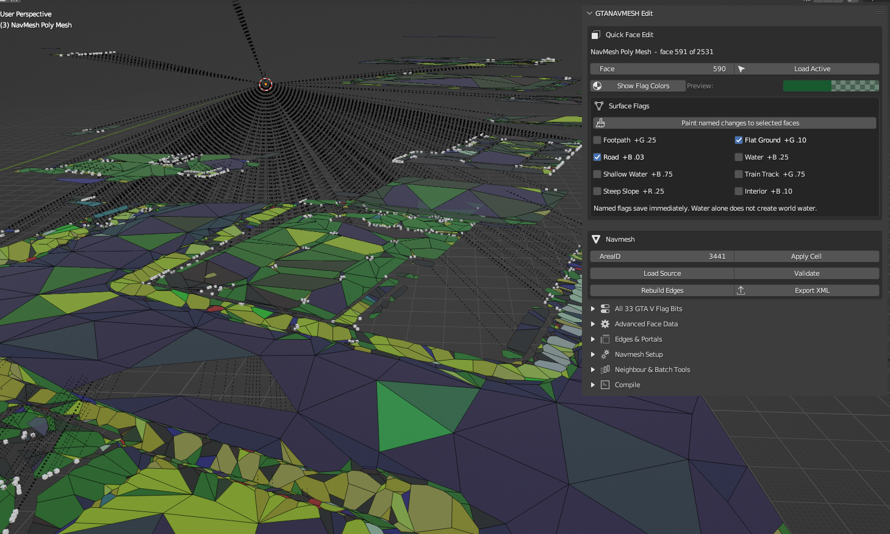

# GTANAVMESH Edit

**GTANAVMESH Edit** is a Blender add-on for importing, editing, validating and
exporting GTA V YNV navmesh data as CodeWalker-compatible `.ynv.xml` files.
It is built for an XML-first workflow: inspect and edit the navmesh in
Blender, validate the result, then optionally compile it to a native RSC7
`.ynv` file.

The direct input format is `.ynv.xml`; GTANAVMESH Edit does not decode or
import native binary `.ynv` files. Binary output remains an optional separate
compiler step after XML validation.

Version: **v0.12.2**
Copyright © 2026 devsanja

> Unofficial community tool. GTANAVMESH Edit is not affiliated with, endorsed
> by, or associated with Rockstar Games or Take-Two Interactive.



Colored navmesh polygons and the Quick Face Edit panel in Blender.

## Highlights in v0.12.2

- Direct import and export of `.ynv.xml` from Blender's **File** menu and the
  **GTANAVMESH Edit** sidebar.
- A visible, structured GTA navmesh editor: cell-level `ContentFlags` toggles,
  all **33 known GTA V polygon bits** grouped by their native flag storage,
  and a per-edge `EdgesFlags` editor. The raw XML-style fields remain
  available for exact inspection and advanced edits.
- `ContentFlags` offers separate **Polygons**, **Portals**, **Vehicle**,
  **Unknown8** and **Unknown16** toggles. Changing a known toggle updates the
  comma-separated value while retaining unrecognised source tokens.
- Each active polygon exposes `Flags1`, `Flags2`, `Flags3`, `Flags4`, `UnkX`,
  `UnkY`, and `Flags5 (B16)` alongside all named bits from **B00** through
  **B32**: avoidance, underground, path-node, interior, interaction,
  footpath, road, water, train-track, shallow-water and all eight
  slope-direction bits. `Unknown` and `Unused` labels remain deliberately
  editable raw data rather than guessed gameplay semantics.
- The compact sidebar starts with **Quick Face Edit**: `Load Active`, **Show
  Flag Colors**, an active-face swatch, eight common surface flags and an
  optional multi-face paint switch. All 33 bits, raw values, edges, portals,
  setup, neighbour and compiler actions remain available in named foldouts.
- **CodeWalker flag colors** use CodeWalker's additive packed-flag calculation
  with its 0.75 alpha. **Show Flag Colors** switches the current 3D View to
  Material Preview; **Refresh Colors** reapplies display materials without
  changing any YNV data. **Load Source** and **Use Selected** refresh those
  materials automatically. Not every known bit has a visible color contribution.
- The sidebar is safe to open on a new, imported or Sollumz navmesh: panel
  drawing is read-only, so Blender never receives an illegal metadata write
  while it is rendering the interface.
- For fast painting, **Paint named changes to selected faces** changes only the
  clicked bit on every selected face and preserves each face's other bits and
  raw `UnkX`/`UnkY` bytes. Named flags save immediately; raw-field edits are
  committed with **Apply Raw Face Data** in **Advanced Face Data**.
- In **Edges & Portals**, choose an edge row to edit its packed `EdgesFlags` parts directly:
  `Poly1 Unk2`, `Poly1 Unk3`, `Poly2 Unk2` and `Poly2 Unk3`.
- Stable face IDs preserve metadata when Blender reorders faces. Deleted
  source polygons are not silently restored during export.
- Retains source `AreaID`, `ContentFlags`, bounds, polygon flags, `Edges`,
  `EdgesFlags`, portals and points where the live geometry still matches the
  source.
- Rebuilds local and loaded-neighbour edge links from shared borders and
  writes reciprocal cross-cell links for both loaded cells.
- **Load Neighbours** safely imports existing adjacent source XML cells from
  the selected cell's source folder using CodeWalker's AreaID/file-name grid.
  It skips already loaded, missing, unreadable and AreaID-mismatched files.
- **Generate Navmesh From Selected Mesh** converts world-space collision or
  regular mesh triangles into a separate navmesh, filters degenerate/too-steep
  surfaces, creates local links, and offers conservative Flat Ground,
  Footpath, Road or empty flag presets.
- Adding a point or portal now requires a real navmesh root. A new portal is
  immediately attached to the active face (`PolyFrom`) and, when a second face
  is selected, to that face as `PolyTo`; its polygon portal-reference rows are
  written at creation time.
- Reads and writes standard Sollumz navmesh, point and portal properties when
  Sollumz is installed; it also works without Sollumz for XML import/export.
- Validates the XML against CodeWalker-oriented structural and packed-field
  limits before it is written.
- Optionally invokes a separately built local .NET compiler to create and
  check a native RSC7 `.ynv` file.

## Download and install

1. Open the v0.12.2 release and download
   **`GTANAVMESH-Edit-v0.12.2.zip`**. Do not unpack it before installation.
2. In Blender, open **Edit > Preferences > Add-ons**.
3. Choose **Install...**, select the downloaded ZIP, then enable
   **GTANAVMESH Edit**.
4. Open a 3D Viewport sidebar (`N`) and select the **GTANAVMESH Edit** tab.
5. Import a source file with **File > Import > YNV NavMesh XML (.ynv.xml)**.

The add-on supports Blender **2.80+**, including Blender 3.x and 4.x. Blender
2.79 and older are not supported.

To update, install the new release ZIP and reload or reinstall the add-on in
Blender Preferences so that Blender does not retain an older module in memory.

## Requirements and optional tools

| Component | Required? | Purpose |
| --- | --- | --- |
| Blender 2.80+ | Yes | Runs GTANAVMESH Edit. |
| Original `.ynv.xml` | Strongly recommended | Supplies authoritative cell metadata for an existing navmesh. |
| Sollumz | Optional, separate install | Its imported navmeshes and RNA properties are supported directly. |
| CodeWalker | Optional, separate install | Recommended for inspecting exported XML and testing the target mod workflow. |
| CodeWalker.Core | Optional build dependency | Needed only to build `ynv_compiler` from source. |
| .NET 8 SDK on Windows | Optional | Needed only when building `ynv_compiler` from source. |

The add-on never needs CodeWalker or Sollumz merely to open, edit or export
XML. Native `.ynv` compilation is intentionally separate and opt-in.

The release asset contains only GTANAVMESH Edit. It does not package Sollumz,
CodeWalker, CodeWalker.Core, GTA V files or other third-party assets. Install
or obtain optional tools separately. See [third-party notices](THIRD_PARTY_NOTICES.md).

## Typical workflow

### Edit an existing navmesh

1. Import the exact original `.ynv.xml` using **Import YNV XML**.
2. Check `Source XML`, `AreaID`, polygon count and portal count in the
   **GTANAVMESH Edit** panel before changing geometry.
3. Edit faces, flags, points or portals.
4. If topology or a cell boundary changed, choose **Load Neighbours** while
   the source XML is bound, keep the affected cells loaded, then use
   **Rebuild Edges**. Use **Export All** for multi-cell edits.
5. Run **Validate**, then export `.ynv.xml`.
6. Inspect the XML in CodeWalker and test the final replacement in the exact
   target game/mod-loading setup.

For an unmodified Rockstar source, normal validation may report legacy
warnings such as zero-area corners or one-way local links. This is expected:
**Strict Validation** is off by default so these sources remain inspectable.
Enable it for newly authored geometry and final quality review.

### Edit cell flags, polygon flags and edge flags

1. Select the navmesh mesh and use **Use Selected** if necessary.
2. Open **Navmesh Setup** and use the `ContentFlags` toggles for **Polygons**,
   **Portals**, **Vehicle**, **Unknown8** and **Unknown16**. Preserve unknown
   source values unless you know the target cell requires a change.
3. Select a face and choose **Load Active** in **Quick Face Edit**. Use its
   common surface flags, or open **All 33 GTA V Flag Bits** for every native
   bit. Enable **Paint named changes to selected faces** to paint only one
   named bit across a face selection without replacing other per-face data.
   Use **Advanced Face Data** only when changing the raw/numeric flag values.
4. In **Edges & Portals**, choose the zero-based **Edge** row, then edit the two
   `Unk2` values (0–3) and two `Unk3` values (0–2047). The row is represented
   as `Poly1 Unk2:Poly1 Unk3, Poly2 Unk2:Poly2 Unk3`.
5. Use **Apply Raw Face Data** after raw values, run **Validate**, then export.
   Keep one `Edges` and one
   `EdgesFlags` row for every vertex of the edited polygon.

Named bit labels are editing aids, not a promise of a fully known GTA gameplay
meaning for every bit. Review unfamiliar or `Unknown` values against the
original cell and in CodeWalker before changing them.

Use **Show Flag Colors** in a 3D View to switch to Material Preview and see
the additive CodeWalker-style color result of the packed flags. Quick labels
and bit-control tooltips identify visible color contributions; all other bits
remain fully editable despite deliberately having no CodeWalker display tint.
The preview is diagnostic only: a color does not establish that a particular
set of flags is appropriate for gameplay. **Refresh Colors**, in **Advanced
Face Data**, is useful after raw bulk edits or after opening an older `.blend`.

### Create a new cell

1. Assign a unique valid `AreaID` first.
2. Choose **New Navmesh**, then build only walkable faces.
3. Set polygon flags, add points/portals only when their target faces are
   known, and use **Rebuild Edges**.
4. Load all changed neighbours, rebuild the boundary links, validate and use
   **Export All**.

New geometry has no authoritative source topology. Review all newly opened,
portal and cross-cell links before release or game testing.

### Generate a navmesh from collision or a regular mesh

1. Set the target `AreaID` and `ContentFlags` in the panel. `AreaID` **0** is
   valid when it is the intended cell; the supported range is 0–16382.
2. Select a non-navmesh mesh. In Object Mode every face is considered; in Edit
   Mode only selected faces are considered.
3. Choose **Generate Navmesh From Selected Mesh**, set the maximum walkable
   slope and a starting flag preset, then confirm.
4. Review the new, separate navmesh. The generator triangulates faces in world
   space, flips downward winding, skips degenerate/too-steep triangles and can
   remove exact duplicate triangles. It does not edit the source mesh.
5. Add deliberate points/portals, load neighbouring cells if needed, rebuild
   edges, validate, inspect the XML in CodeWalker and test the result.

This is a geometry conversion helper, not CodeWalker's full collision/raycast
navmesh authoring system. It cannot infer portal intent, per-edge behavior,
area boundaries, obstacles, or gameplay-safe flags. Resolve non-manifold/open
edges and review every generated surface before use.

## Source binding and safe export behavior

The Source XML is not just a template. It records data that geometry alone
cannot reliably recreate: cell identity, edge references, edge flags, portal
references, points and bounds.

Use **Load Source** to bind the exact original file to an existing mesh.
`Fix Sources` is an opt-in recovery helper for a moved `.blend`, not an
automatic authority. If **Auto Find Source** is enabled, lookup is restricted
to the blend/export folder and the explicitly chosen source-search folder. A
candidate must have equal polygon count, near-identical bounds and be unique;
a manually selected source is never replaced.

An explicit `AreaID` is authoritative even when it is **0**. Zero is a real
CodeWalker cell ID, not a missing value; only the edge sentinel `16383` is
reserved. Do not change an imported `AreaID` merely because it displays as
zero.

Export always uses the current Blender face list:

- A deleted source face stays deleted in the output.
- A matching surviving face retains its applicable source metadata.
- A new face receives valid defaults rather than unrelated source topology.
- A link to a deleted target becomes an open edge rather than reviving a
  source polygon.

Keep an untouched source XML outside the export directory. After substantial
changes, inspect the export rather than assuming a geometry-only rebuild
understands gameplay intent.

## XML validation and native compilation

The exporter validates the live model before writing. The checks include
polygon vertex counts, 6/7-byte flags, per-edge link rows, portal references,
single-precision-safe floats, bounds, `EdgesFlags` and the native limit of 32
adjacent AreaIDs.

To build the optional compiler from a PowerShell prompt at the repository
root, provide a compatible local `CodeWalker.Core` project if it is not at the
default sibling path expected by `ynv_compiler.csproj`:

```powershell
dotnet build .\ynv_compiler\ynv_compiler.csproj -c Release `
  /p:CodeWalkerCoreProject=C:\src\CodeWalker\CodeWalker.Core\CodeWalker.Core.csproj
```

The Windows executable is then expected at:

```text
ynv_compiler\bin\Release\net8.0\ynv_compiler.exe
```

In the add-on, set **YNV Compiler** to that executable and run **Compile
YNV** after exporting a validated XML. The equivalent command-line workflow
is:

```powershell
& .\ynv_compiler\bin\Release\net8.0\ynv_compiler.exe `
  .\export\navmesh[123][99].ynv.xml `
  .\export\navmesh[123][99].ynv

& .\ynv_compiler\bin\Release\net8.0\ynv_compiler.exe `
  --check .\export\navmesh[123][99].ynv
```

The compiler only replaces the native output after it has passed an in-memory
RSC7 read/validation round trip. A successful `--check` proves binary
readability by the CodeWalker.Core-based reader used by the compiler; it does not prove
in-game navigation behavior.

## Repository layout

| Path | Contents |
| --- | --- |
| `ynv_blender_addon/` | Blender add-on source. |
| `ynv_compiler/` | Optional .NET 8 XML-to-RSC7 compiler. |
| `tools/package_blender_addon.py` | Deterministic release ZIP builder and layout verifier. |
| `docs/` | Detailed import, source-binding and editing guides. |
| `RELEASE_NOTES.md` | v0.12.2 release summary and verification scope. |
| `CHANGELOG.md` | Version history. |
| `THIRD_PARTY_NOTICES.md` | External dependency and affiliation notice. |

The optional CodeWalker.Core build dependency and Sollumz integration are
external to the release asset; they are not add-on payload files.

## Building a release ZIP

Build every Blender release ZIP with the repository packaging script rather
than a generic archive command:

```powershell
py .\tools\package_blender_addon.py --version 0.12.2
py .\tools\package_blender_addon.py --check `
  .\dist\GTANAVMESH-Edit-v0.12.2.zip
```

The builder creates `dist/GTANAVMESH-Edit-v0.12.2.zip`, rejects accidental
replacement unless `--force` is supplied, and prints the SHA-256 digest. It
also writes a real `ynv_blender_addon/` directory entry as the first ZIP
member. That explicit package-root entry is required by this project's Blender
installation workflow; an archive containing only
`ynv_blender_addon/__init__.py` file records is rejected by `--check`.

Use the `--output` option only when a nonstandard artifact destination is
needed. Before publishing, run `--check` against the exact ZIP that will be
uploaded, install that ZIP in a clean Blender profile, enable the add-on, and
confirm that the **GTANAVMESH Edit** sidebar tab is present.

## Release verification

The v0.12.2 release checklist includes:

- Python syntax compilation for the add-on modules.
- Blender 3.5.1 background registration and unregistration.
- A Blender 3.5 panel-draw regression test in Object and Edit Mode with an
  uninitialized navmesh, confirming the sidebar does not write ID data while
  Blender is drawing it.
- Direct XML import and re-export of a 2,534-polygon sample, preserving
  bounds, `EdgesFlags` and portal links.
- Deletion of one imported face, confirming that export contains exactly
  2,533 polygons and does not revive the source face.
- Reciprocal cross-cell link generation with two adjacent test cells.
- Cell `ContentFlags`, named polygon-bit, raw polygon-field and selected-edge
  flag editor synchronization.
- Full 33-bit group coverage, per-bit multi-face painting, exact raw-flag
  matching and CodeWalker material-color refresh.
- Safe point/portal creation, portal-reference rows and AreaID `0`
  preservation.
- Neighbour source-path mapping/AreaID mismatch handling and selected-mesh
  generation with slope filtering.
- Python validation boundary checks, including AreaID, float and
  adjacent-area limits.
- Release build of `ynv_compiler`, followed by XML-to-RSC7 compilation and
  `--check` verification.
- A real 2,824-polygon YNV XML edit: Road to Water + ShallowWater, deletion of
  a second road polygon, edge rebuild, export, native CodeWalker-Core
  validation, RSC7 compilation and re-read (`AreaID 4039`, 2,823 polygons).

For every release, additionally verify the exact upload ZIP with
`tools/package_blender_addon.py --check`; it requires an explicit
`ynv_blender_addon/` package-root directory entry.

These checks establish structural compatibility and binary readability. They
do not replace review in CodeWalker or in-game behavior testing for a specific
mod configuration.

## More documentation

- [Import, source binding and native compilation](docs/YNV_Import_Source_Compile.md)
- [Navmesh tools user guide](docs/YNV_NavMesh_Tools_Guide.md)
- [v0.12.2 release notes](RELEASE_NOTES.md)
- [Changelog](CHANGELOG.md)
- [Third-party notices](THIRD_PARTY_NOTICES.md)

Copyright © 2026 devsanja
